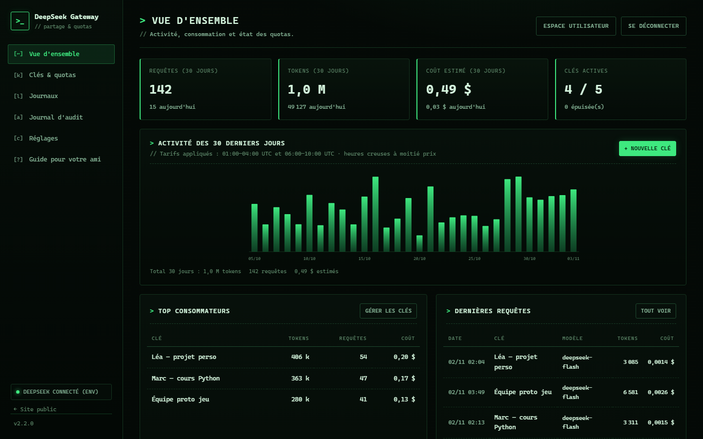
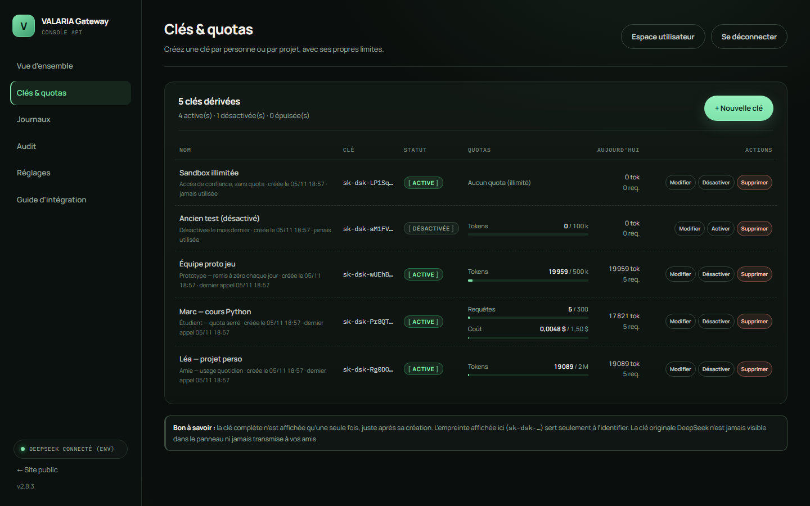
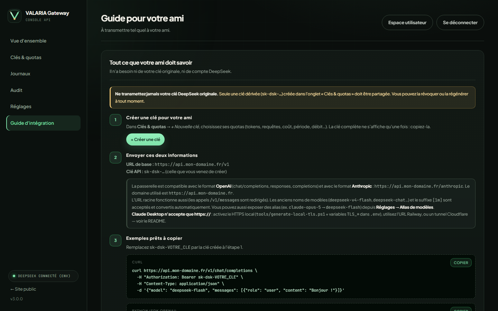

# DeepSeek Gateway

**Partagez votre clé API DeepSeek avec un ami, sans lui donner votre clé et sans perdre le contrôle.**
Votre clé originale reste sur votre machine. Vous créez pour votre ami une **clé dérivée** (`sk-dsk-…`)
avec ses propres quotas : tokens, requêtes, coût, débit, modèles autorisés, date d'expiration.
Un **panneau web** en français permet de tout gérer et de suivre la consommation en temps réel.



---

## Sommaire

- [Fonctionnalités](#fonctionnalités)
- [Architecture](#architecture)
- [Démarrage rapide (Windows)](#démarrage-rapide-windows)
- [Configuration (.env)](#configuration-env)
- [Créer une clé pour votre ami](#créer-une-clé-pour-votre-ami)
- [Utilisation côté ami](#utilisation-côté-ami)
- [Limites et quotas disponibles](#limites-et-quotas-disponibles)
- [Tarifs et estimation des coûts](#tarifs-et-estimation-des-coûts)
- [Alias de modèles (déguisement)](#alias-de-modèles-déguisement)
- [Exposer la passerelle sur Internet](#exposer-la-passerelle-sur-internet)
- [HTTPS local (Claude Desktop)](#https-local-claude-desktop)
- [Docker](#docker)
- [Déployer sur Railway](#déployer-sur-railway)
- [Données, sauvegardes et sécurité](#données-sauvegardes-et-sécurité)
- [Tests](#tests)
- [Structure du projet](#structure-du-projet)
- [Dépannage / FAQ](#dépannage--faq)
- [Limites connues](#limites-connues)

---

## Fonctionnalités

- **Votre clé originale n'est jamais exposée.** Elle n'est utilisée que par la passerelle, côté serveur.
  Seules vos clés dérivées sont partagées, et elles sont stockées **hachées** (SHA-256).
- **Clés dérivées à la carte**, une par personne ou par projet, révocables, régénérables, désactivables.
- **Quotas cumulables** : tokens, nombre de requêtes, coût estimé (USD), par jour / mois / total.
- **Limites anti-abus** : requêtes par minute, requêtes simultanées, plafond de tokens de sortie,
  liste de modèles autorisés, date d'expiration.
- **Comptage réel des tokens** : l'`usage` renvoyé par DeepSeek est lu pour les réponses classiques
  **et pour le streaming SSE** (le dernier événement contient les statistiques). En cas de
  déconnexion, une estimation est enregistrée pour éviter les contournements de quota.
- **Coût estimé** aux tarifs DeepSeek, avec distinction **heures pleines / heures creuses**.
- **Panneau web complet** : tableau de bord, gestion des clés, journaux des requêtes, réglages,
  guide prêt à envoyer à votre ami.
- **Compatible OpenAI et Anthropic** : `/v1/chat/completions`, `/v1/responses`, `/beta/completions`,
  `/v1/models`, et `/anthropic/...` (Chat Completions, Responses API, FIM, format compatible Claude).
- **Claude Code prêt à l'emploi** : les requêtes Anthropic `/v1/messages` (envoyées par Claude Code)
  sont automatiquement redirigées vers `/anthropic/v1/messages`, et les anciens noms de modèles
  (`deepseek-v4-flash`, `deepseek-chat`, `deepseek-reasoner`, variantes `[1m]`…) sont convertis
  vers les noms canoniques (`deepseek-flash`, `deepseek-v4-pro`).
- **Alias de modèles** : exposez le nom de votre choix (ex. `claude-opus-5`) tout en servant
  réellement un modèle DeepSeek (`deepseek-flash` par défaut). Les quotas et le coût restent
  calculés sur le modèle facturé.
- **HTTP + HTTPS** : HTTP sur `8787` et, si un certificat est fourni, HTTPS sur `8788`
  (requis par Claude Desktop). Voir [HTTPS local](#https-local-claude-desktop).
- **Zéro dépendance** : Node.js + SQLite intégré (`node:sqlite`). Pas de `npm install`, pas de build.

## Architecture

```
  Votre ami                        Vous
     │                              │
     │  clé dérivée sk-dsk-…        │  panneau web http://localhost:8787
     ▼                              ▼
┌──────────────────────────────────────────────────────┐
│                  DeepSeek Gateway                     │
│  • authentifie la clé dérivée (hash)                  │
│  • applique les quotas / débit / modèles              │
│  • transmet à l'API DeepSeek avec VOTRE clé originale │
│  • lit l'usage renvoyé, met à jour les compteurs      │
│  • journalise requête, tokens, coût estimé            │
└──────────────────────────┬───────────────────────────┘
                           │  Authorization: Bearer sk-… (clé originale)
                           ▼
                  https://api.deepseek.com
```

Données stockées localement dans `data/gateway.db` (SQLite). Aucun service tiers, aucun cloud.

## Démarrage rapide (Windows)

1. **Vérifiez Node.js** (24 LTS ou supérieur, 26 recommandé) :
   ```powershell
   node --version
   ```
2. **Configurez** : copiez `.env.example` en `.env`, puis renseignez au minimum :
   ```env
   DEEPSEEK_API_KEY=sk-votre-cle-originale
   ```
3. **Démarrez** : double-cliquez sur `start.bat`, ou dans un terminal :
   ```powershell
   node server.js
   ```
4. **Ouvrez le panneau** : <http://127.0.0.1:8787>
   - Mot de passe : la valeur de `ADMIN_PASSWORD` si vous en avez défini une,
   - sinon un mot de passe aléatoire a été généré et affiché dans la console ;
     il est aussi écrit dans `data/admin-password.txt`. Changez-le dans **Réglages**.
5. **Créez une clé** dans **Clés & quotas** → **+ Nouvelle clé**, choisissez les quotas,
   puis copiez la clé (elle ne sera plus jamais affichée en entier).
6. **Envoyez à votre ami** l'URL de base et la clé (voir [Utilisation côté ami](#utilisation-côté-ami)).

> Par défaut la passerelle n'écoute que sur `127.0.0.1` : elle n'est pas accessible depuis Internet.
> Pour la partager, voir [Exposer la passerelle sur Internet](#exposer-la-passerelle-sur-internet).

## Configuration (.env)

Les variables d'environnement ont priorité sur le fichier `.env`. Toutes les valeurs sont optionnelles
sauf `DEEPSEEK_API_KEY` (ou la clé saisie dans le panneau).

| Variable | Défaut | Rôle |
|---|---|---|
| `DEEPSEEK_API_KEY` | — | Clé API DeepSeek **originale**. Ne jamais partager. |
| `HOST` | `127.0.0.1` | Interface d'écoute (`0.0.0.0` pour un VPS/Docker). |
| `PORT` | `8787` | Port d'écoute. |
| `PUBLIC_BASE_URL` | `http://<hôte>:<port>` | URL publique affichée dans le guide (ex. `https://api.mondomaine.fr`). |
| `ADMIN_PASSWORD` | généré | Mot de passe initial du panneau (utilisé **au premier démarrage** uniquement). |
| `SESSION_HOURS` | `12` | Durée d'une session admin. |
| `TRUST_PROXY` | `0` | `1` derrière un reverse proxy HTTPS (cookie `Secure`, IP réelles). |
| `DEEPSEEK_BASE_URL` | `https://api.deepseek.com` | À modifier seulement pour un proxy intermédiaire. |
| `DATA_DIR` | `./data` | Dossier de la base SQLite (une valeur vide = `./data`). |
| `MAX_BODY_BYTES` | `33554432` (32 Mo) | Taille maximale d'une requête entrante. `0` = illimité (attention à la mémoire). |
| `UPSTREAM_TIMEOUT_MS` | `1800000` | Délai maximal d'un appel vers DeepSeek (30 min). |
| `LOG_LEVEL` | `info` | `debug`, `info`, `warn`, `error`. |
| `HTTPS_PORT` | `8788` | Port HTTPS (actif seulement si un certificat est configuré). |
| `TLS_CERT_FILE` | — | Certificat PEM (`data/tls/server.crt`). |
| `TLS_KEY_FILE` | — | Clé privée PEM (`data/tls/server.key`). |
| `TLS_PFX_FILE` | — | Alternative Windows : certificat PFX. |
| `TLS_PFX_PASSPHRASE` | — | Mot de passe du PFX. |

## Créer une clé pour votre ami

Dans le panneau, onglet **Clés & quotas** → **+ Nouvelle clé** :

| Champ | Exemple | Explication |
|---|---|---|
| Nom | `Ami — projet perso` | Pour vous y retrouver. |
| Quota de tokens | `5000000` | Vide = illimité. Remis à zéro selon la période. |
| Quota de requêtes | `500` | Vide = illimité. |
| Quota de coût (USD) | `3.50` | Plafond du coût estimé. |
| Période | `par mois` | `par jour`, `par mois` ou `total` (jamais remis à zéro). |
| Requêtes/minute | `20` | Anti-abus, fenêtre glissante de 60 s. |
| Requêtes simultanées | `2` | Évite les rafales parallèles. |
| Tokens de sortie max | `4096` | Plafonne le `max_tokens` envoyé par votre ami. |
| Modèles autorisés | `deepseek-flash` | Vide = tous. Sinon liste séparée par des virgules. |
| Date d'expiration | `2027-01-01 00:00` | Après cette date, la clé est refusée. |

La clé complète (`sk-dsk-…`) n'est affichée **qu'une seule fois**, juste après la création.
Le panneau ne conserve que son empreinte `sk-dsk-abcde…` et un hachage en base.



Actions disponibles à tout moment : **Modifier**, **Désactiver/Activer**, **Réinitialiser** les compteurs,
**Nouvelle clé** (l'ancienne cesse immédiatement de fonctionner), **Supprimer** (efface aussi ses journaux).

## Utilisation côté ami

Votre ami reçoit deux informations :
- **URL de base** : `https://votre-domaine/v1` (ou `http://VOTRE-IP:8787/v1` en réseau local) ;
- **clé API** : `sk-dsk-…`.

### cURL

```bash
curl https://votre-domaine/v1/chat/completions \
  -H "Authorization: Bearer sk-dsk-VOTRE_CLE" \
  -H "Content-Type: application/json" \
  -d '{"model": "deepseek-flash", "messages": [{"role": "user", "content": "Bonjour !"}]}'
```

### Python (SDK OpenAI)

```python
from openai import OpenAI

client = OpenAI(
    api_key="sk-dsk-VOTRE_CLE",
    base_url="https://votre-domaine/v1",
)

reponse = client.chat.completions.create(
    model="deepseek-flash",
    messages=[{"role": "user", "content": "Bonjour !"}],
)
print(reponse.choices[0].message.content)
```

### Node.js (SDK OpenAI)

```javascript
import OpenAI from "openai";

const client = new OpenAI({
  apiKey: "sk-dsk-VOTRE_CLE",
  baseURL: "https://votre-domaine/v1",
});

const reponse = await client.chat.completions.create({
  model: "deepseek-flash",
  messages: [{ role: "user", content: "Bonjour !" }],
});
console.log(reponse.choices[0].message.content);
```

### Outils compatibles OpenAI (variables d'environnement)

```env
OPENAI_BASE_URL=https://votre-domaine/v1
OPENAI_API_KEY=sk-dsk-VOTRE_CLE
```

### Format Anthropic / Claude Code

```env
ANTHROPIC_BASE_URL=https://votre-domaine/anthropic
ANTHROPIC_AUTH_TOKEN=sk-dsk-VOTRE_CLE
ANTHROPIC_MODEL=deepseek-flash
ANTHROPIC_DEFAULT_OPUS_MODEL=deepseek-v4-pro
ANTHROPIC_DEFAULT_SONNET_MODEL=deepseek-flash
ANTHROPIC_DEFAULT_HAIKU_MODEL=deepseek-flash
CLAUDE_CODE_SUBAGENT_MODEL=deepseek-flash
```

- `ANTHROPIC_API_KEY` fonctionne aussi à la place de `ANTHROPIC_AUTH_TOKEN` (envoyé en `x-api-key`).
- L'URL **sans** `/anthropic` fonctionne également : `/v1/messages` est redirigé automatiquement
  vers `/anthropic/v1/messages`.
- Les anciens noms de modèles sont acceptés (`deepseek-v4-flash`, `deepseek-chat`…) ainsi que le
  suffixe de variante `[1m]` (`deepseek-flash[1m]`), qui est conservé tel quel.

> 💡 Claude Code envoie un prompt système volumineux (~20 000 tokens par requête). Si vous fixez un
> quota de tokens à votre ami, prévoyez-le en conséquence (par exemple 2–5 M par mois).

La passerelle accepte l'authentification par `Authorization: Bearer …` **ou** par `x-api-key: …`.



## Limites et quotas disponibles

| Limite | Champ | Remis à zéro |
|---|---|---|
| Tokens consommés | `quotaTokens` | période choisie |
| Nombre de requêtes | `quotaRequests` | période choisie |
| Coût estimé USD | `quotaUsd` | période choisie |
| Débit (requêtes/minute) | `rpmLimit` | fenêtre glissante 60 s |
| Requêtes simultanées | `concurrencyLimit` | à chaque fin de requête |
| Tokens de sortie | `maxOutputTokens` | — (plafonne `max_tokens`) |
| Modèles autorisés | `allowedModels` | — |
| Expiration | `expiresAt` | — |

Les périodes sont calculées en **UTC** (un quota « par jour » se remet à zéro à minuit UTC,
un quota « par mois » le 1er du mois à 00:00 UTC).

Votre ami peut suivre son quota via les **en-têtes de réponse** :
`x-quota-tokens-remaining`, `x-quota-requests-remaining`, `x-quota-usd-remaining`,
`x-quota-tokens-limit`, `x-quota-requests-limit`, `x-quota-period`.
Ils indiquent la valeur **au début** de la requête.

| HTTP | Code | Signification |
|---|---|---|
| 401 | `missing_api_key` / `invalid_api_key` | Clé absente, inconnue ou révoquée |
| 403 | `client_disabled` / `client_expired` | Clé désactivée ou expirée |
| 403 | `model_not_allowed` | Modèle hors de la liste autorisée |
| 429 | `insufficient_quota` | Quota tokens / requêtes / coût atteint |
| 429 | `rate_limit_exceeded` | Trop de requêtes par minute |
| 429 | `concurrency_limit_exceeded` | Trop de requêtes simultanées |
| 503 | `provider_not_configured` | Clé DeepSeek originale manquante côté admin |

## Tarifs et estimation des coûts

Les tarifs publics DeepSeek (2026, USD par million de tokens) sont préchargés :

| Modèle | Cache hit (creux / plein) | Cache miss (creux / plein) | Sortie (creux / plein) |
|---|---|---|---|
| `deepseek-flash` | 0.003 / 0.006 | 0.15 / 0.30 | 0.60 / 1.20 |
| `deepseek-v4-pro` | 0.022 / 0.044 | 0.66 / 1.32 | 1.98 / 3.96 |

- **Heures pleines** : 01:00–04:00 et 06:00–10:00 UTC, du lundi au vendredi
  (hors jours fériés chinois, liste `holidays` modifiable dans le JSON du panneau).
- Ces montants servent **uniquement à estimer** les quotas de coût, pas à facturer.
- Ils sont modifiables dans **Réglages → Tarification** (JSON) si DeepSeek change ses prix.
- Les modèles inconnus (anciens noms) utilisent le tarif de repli (`deepseek-flash` par défaut).

## Alias de modèles (déguisement)

Vous pouvez exposer aux clients (Claude Code, SDK OpenAI…) un **nom de modèle différent** de
celui réellement utilisé par DeepSeek. Un alias est une simple règle
« nom demandé → modèle DeepSeek » :

```json
{
  "claude-opus-5*": "deepseek-flash",
  "fable-5": "deepseek-flash",
  "fable-5.1": "deepseek-flash"
}
```

- `claude-opus-5*` est un motif : il couvre `claude-opus-5`, `claude-opus-5-20260101`, etc.
- Un alias exact (`"mon-modele": "deepseek-flash"`) est aussi possible ; le motif le plus précis gagne.
- **Par défaut**, les alias `claude-opus-5*`, `fable-5` et `fable-5.1` sont déjà actifs et
  pointent tous vers `deepseek-flash` : ces noms utilisent le modèle DeepSeek économique,
  jamais le pro. Pour utiliser le pro, remplacez la cible par `deepseek-v4-pro` dans le panneau.
- Ils apparaissent aussi dans la découverte de modèles (`/v1/models` et `/anthropic/v1/models`).

Modifiable dans le panneau : **Réglages → Alias de modèles** (JSON). Videz le champ puis
enregistrez pour revenir aux alias par défaut. Le remplacement de la table annule les alias
par défaut : ajoutez-les explicitement si vous les conservez.

**Ce qui reste réel (par transparence) :**

- Les **quotas, le coût estimé et les journaux** utilisent le modèle DeepSeek réellement facturé.
- Le **journal** enregistre aussi le **modèle demandé** : dans le panneau, la colonne « Modèle »
  affiche par exemple `fable-5.1` avec, en dessous, `facturé : deepseek-flash`, et le coût réel
  correspondant. L'API des journaux expose `requestedModel` (nom demandé) et `model` (modèle facturé).
- Le client reçoit les en-têtes `x-gateway-requested-model` (nom demandé) et
  `x-gateway-billed-model` (modèle réel).
- La réponse de l'API contient le nom du modèle DeepSeek (le « déguisement » se fait au niveau
  du nom demandé par le client / de son affichage, pas en falsifiant la facture).

Exemple avec Claude Code : mettez `ANTHROPIC_MODEL=claude-opus-5` dans ses variables ; il
affichera « Opus 5 » et la passerelle servira `deepseek-flash`.
Pour être certain qu'aucun modèle pro ne soit jamais utilisé, renseignez aussi la liste
**Modèles autorisés** de la clé dérivée à `deepseek-flash` (panneau → Modifier).

## Exposer la passerelle sur Internet

Trois options, de la plus simple à la plus « production ».

### A. Cloudflare Tunnel (pas d'IP publique, HTTPS gratuit)

```powershell
# Installez cloudflared, puis :
cloudflared tunnel --url http://127.0.0.1:8787
```
Cloudflare vous donne une URL `https://xxx.trycloudflare.com` : mettez-la dans
`PUBLIC_BASE_URL` et envoyez `https://xxx.trycloudflare.com/v1` à votre ami.
Pour un tunnel permanent, créez un tunnel nommé avec votre domaine.

### B. VPS + Caddy (HTTPS automatique, recommandé)

Sur un serveur Linux (Debian/Ubuntu), installez Node.js 24+, copiez le projet, puis :

```bash
# 1. .env
HOST=127.0.0.1
PORT=8787
DEEPSEEK_API_KEY=sk-...
PUBLIC_BASE_URL=https://api.mondomaine.fr
ADMIN_PASSWORD=un-mot-de-passe-long-et-unique
TRUST_PROXY=1

# 2. service systemd /etc/systemd/system/deepseek-gateway.service
[Unit]
Description=DeepSeek Gateway
After=network.target

[Service]
WorkingDirectory=/opt/deepseek-gateway
ExecStart=/usr/bin/node server.js
Restart=always
User=www-data

[Install]
WantedBy=multi-user.target

# 3. Caddyfile
api.mondomaine.fr {
    reverse_proxy 127.0.0.1:8787
}
```

```bash
systemctl enable --now deepseek-gateway
systemctl reload caddy
```

Ouvrez uniquement les ports 80/443 dans le pare-feu. Le panneau est alors accessible sur
`https://api.mondomaine.fr/` (protégé par mot de passe + cookie `Secure`).

### C. Réseau local / test rapide

Mettez `HOST=0.0.0.0`, ouvrez le port dans le pare-feu Windows, et donnez à votre ami
`http://VOTRE-IP-LOCALE:8787/v1`. À réserver au réseau de confiance (pas d'HTTPS).

## HTTPS local (Claude Desktop)

Certains clients (dont **Claude Desktop**) n'acceptent que des URL `https://`. La passerelle
peut servir **HTTP et HTTPS en parallèle** : HTTP sur `PORT` (8787), HTTPS sur `HTTPS_PORT`
(8788) dès qu'un certificat est configuré. Les deux modes sont donc disponibles.

### Option 1 — La plus simple : tunnel HTTPS (aucun certificat)

```powershell
winget install --id Cloudflare.cloudflared --accept-source-agreements --accept-package-agreements
cloudflared tunnel --url http://127.0.0.1:8787
```

Cloudflare affiche une URL `https://xxxx.trycloudflare.com`. Dans Claude Desktop, utilisez
`https://xxxx.trycloudflare.com/anthropic` comme URL de base (ou la racine) + une clé dérivée.
Fonctionne aussi pour un ami à distance. L'URL change à chaque redémarrage du tunnel.

### Option 2 — HTTPS natif avec certificat local (recommandé en local)

```powershell
pwsh -File tools/generate-local-tls.ps1
```

Le script crée une autorité de certification locale + un certificat serveur dans `data/tls/`,
installe la CA dans Windows (Claude Desktop, navigateurs et Electron lui font alors confiance)
et affiche les lignes à ajouter dans `.env` :

```env
HTTPS_PORT=8788
TLS_CERT_FILE=data/tls/server.crt
TLS_KEY_FILE=data/tls/server.key
```

Redémarrez la passerelle : `https://localhost:8788/`, `https://127.0.0.1:8788/` et
`https://VOTRE-IP-LAN:8788/` sont disponibles, en plus de l'HTTP sur 8787.

Dans Claude Desktop, utilisez comme URL de base :
`https://127.0.0.1:8788/anthropic` (ou `https://192.168.x.x:8788/anthropic` depuis un autre PC
du réseau, après avoir installé `data/tls/ca.crt` sur ce PC — double-clic → « Installer le
certificat » → *Autorités de certification racines de confiance*).

- Le certificat couvre `localhost`, le nom de la machine et toutes les IPv4 locales.
- Alternative : un certificat PFX existant via `TLS_PFX_FILE` / `TLS_PFX_PASSPHRASE`.
- Linux/macOS : `mkcert -install` puis `mkcert localhost 127.0.0.1`, et pointez
  `TLS_CERT_FILE` / `TLS_KEY_FILE` vers les fichiers générés.

### Option 3 — Railway (HTTPS public fourni)

Railway fournit un domaine HTTPS : dans Claude Desktop, utilisez
`https://VOTRE-DOMAINE.up.railway.app/anthropic` + une clé dérivée.
Voir [Déployer sur Railway](#déployer-sur-railway).

> ⚠️ Le HTTPS local chiffre le trafic sur votre réseau, mais la passerelle reste destinée à un
> usage privé : pour un partage à distance, préférez Railway ou un tunnel.

## Docker

```bash
cp .env.example .env   # renseignez DEEPSEEK_API_KEY et ADMIN_PASSWORD
docker compose up -d --build
```

- Port `8787`, données persistées dans le volume `gateway_data` (monté sur `/data`).
- La santé du conteneur est vérifiée sur `/healthz`.
- L'image démarre en `root` uniquement pour corriger les droits du volume, puis exécute
  l'application avec l'utilisateur non privilégié `node` (`docker-entrypoint.sh`).
- **Pas d'instruction `VOLUME` dans le Dockerfile** : elle est refusée par Railway et
  inutile avec `docker compose` (le volume est déclaré dans `docker-compose.yml`).
- Derrière un reverse proxy, gardez `HOST=0.0.0.0` (déjà forcé dans `docker-compose.yml`).

Sans compose :

```bash
docker build -t deepseek-gateway .
docker run -d --name deepseek-gateway -p 8787:8787 \
  -v deepseek_gateway_data:/data \
  -e DEEPSEEK_API_KEY=sk-... -e ADMIN_PASSWORD=... \
  deepseek-gateway
```

## Déployer sur Railway

Le dépôt est prêt pour Railway : `railway.json` configure le build Dockerfile, le
healthcheck `/healthz` et le redémarrage automatique. Le volume n'est **pas** déclaré
dans le Dockerfile (Railway le refuse) : il se crée dans le tableau de bord et se monte
sur `/data`.

1. **Créer le projet** — Railway → *New Project* → *Deploy from GitHub repo* →
   choisissez `Shayne0804-bit/deepseek-gateway` (autorisez l'accès au dépôt privé).
   Railway détecte automatiquement le `Dockerfile`.
2. **Variables** (service → onglet *Variables*) :
   ```env
   DEEPSEEK_API_KEY=sk-votre-cle-originale
   ADMIN_PASSWORD=un-mot-de-passe-long-et-unique
   TRUST_PROXY=1
   DATA_DIR=/data
   HOST=0.0.0.0
   PUBLIC_BASE_URL=https://VOTRE-DOMAINE.up.railway.app
   ```
   > Ne fixez pas `PORT` : Railway l'injecte automatiquement et l'application l'utilise.
   > `PUBLIC_BASE_URL` peut être renseignée après l'étape 4, puis redéployée.
3. **Volume** — clic droit sur le service → *Attach Volume* (ou *Volumes* → *Add Volume*),
   **Mount path : `/data`** (doit correspondre à `DATA_DIR`). Sans volume, la base SQLite
   (clés dérivées, quotas, journaux) est perdue à chaque redéploiement.
4. **Domaine public** — service → *Settings* → *Networking* → *Generate Domain*.
   Copiez l'URL `https://…up.railway.app`, mettez-la dans `PUBLIC_BASE_URL` et redéployez.
5. **Utiliser** — ouvrez `https://VOTRE-DOMAINE/` : le panneau demande votre
   `ADMIN_PASSWORD`. Créez une clé dérivée, puis donnez à votre ami
   `https://VOTRE-DOMAINE/v1` (ou `…/anthropic` pour Claude Code) et la clé.

Notes :

- Le volume est monté par la plateforme avant le démarrage : l'entrypoint du conteneur
  ajuste ses droits puis lance l'application en utilisateur non privilégié `node`.
- Sur l'offre d'essai, le service peut se mettre en veille ; il redémarre à la demande.
  Vérifiez le journal de déploiement (onglet *Deployments*) si besoin.
- Le disque du conteneur (hors `/data`) est éphémère : n'y stockez rien d'important.

## Données, sauvegardes et sécurité

### Données

- Tout est dans `data/` : `gateway.db` (SQLite, mode WAL) + `admin-password.txt` au premier démarrage.
- Le journal stocke les **métadonnées** des requêtes (modèle, tokens, coût, statut, latence) —
  **pas** le contenu des messages.
- Si vous saisissez la clé originale dans le panneau (et non via `.env`), elle est stockée dans
  `gateway.db` : protégez le dossier `data/` (permissions, sauvegardes chiffrées).

### Sauvegarde

Serveur arrêté, copiez le dossier `data/` (ou au minimum `gateway.db`). À chaud, utilisez
`sqlite3 data/gateway.db ".backup data/backup.db"` si la commande `sqlite3` est disponible.

### Checklist sécurité

- [ ] Jamais votre clé originale dans un chat, un e-mail, un dépôt Git.
- [ ] HTTPS obligatoire dès que le panneau est accessible depuis Internet.
- [ ] Mot de passe admin long et unique (changez celui généré au premier démarrage).
- [ ] Une clé dérivée par personne ; révoquez dès qu'elle n'est plus nécessaire.
- [ ] Quotas raisonnables + `rpmLimit` pour éviter une facture surprise.
- [ ] Sauvegardes régulières de `data/`.
- [ ] Ne commitez jamais `.env` ni `data/` (déjà dans `.gitignore`).

## Tests

```powershell
node --test test
```

La suite (55 tests) couvre : tarification (heures pleines/creuses, cache), calcul des coûts,
normalisation `usage` OpenAI/Anthropic, quotas (tokens, requêtes, coût, reset de période),
limites de débit et de concurrence, authentification admin (hash scrypt, sessions),
chiffrement/hachage des clés dérivées, proxy JSON et **streaming SSE** avec comptage,
liste de modèles autorisés, plafond `max_tokens`, limite de taille du corps (413),
alias de modèles, **découverte de modèles** (`/v1/models` et `/anthropic/v1/models`),
**écouteur HTTPS natif** (HTTP + HTTPS en parallèle), compatibilité Claude Code
(`/v1/messages` → `/anthropic/v1/messages`, alias de modèles), chemins avec slashs multiples,
erreurs et absence de clé fournisseur.
Les tests utilisent un faux serveur DeepSeek local : **aucun appel réseau réel, aucune clé nécessaire**.

## Structure du projet

```
deepseek-gateway/
├── server.js                 # point d'entrée (node server.js)
├── src/
│   ├── app.js                # serveur HTTP, routage, démarrage, bannière
│   ├── config.js             # chargement .env / variables d'environnement
│   ├── db.js                 # schéma SQLite et requêtes
│   ├── settings.js           # clé fournisseur, mot de passe admin, infos serveur
│   ├── auth.js               # clés dérivées (hash), scrypt, sessions admin
│   ├── pricing.js            # tarifs DeepSeek, heures pleines, calcul du coût
│   ├── quota.js              # périodes, quotas, débit, concurrence, journal d'usage
│   ├── proxy.js              # proxy /v1/... et /anthropic/... (JSON + SSE)
│   ├── admin-api.js          # API REST du panneau (/admin/api/...)
│   └── http-utils.js         # helpers HTTP, cookies, erreurs, sécurité
├── public/                   # panneau web (HTML/CSS/JS, sans dépendance)
├── test/                     # tests automatisés (node --test)
├── test/fixtures/tls/        # certificat auto-signé réservé aux tests HTTPS
├── tools/capture-panel.mjs   # captures d'écran de démonstration (dev)
├── tools/generate-local-tls.ps1  # certificat local + CA pour HTTPS (Claude Desktop)
├── docs/                     # captures d'écran
├── data/                     # base SQLite (créée au démarrage, ignorée par Git)
├── start.bat / start.ps1 / start.sh
├── Dockerfile / docker-compose.yml
├── docker-entrypoint.sh     # droits du volume + execution non-root
├── railway.json             # configuration de deploiement Railway
├── .dockerignore
└── .env.example
```

## Dépannage / FAQ

**« provider_not_configured » (503)** — La clé originale manque : renseignez `DEEPSEEK_API_KEY`
dans `.env` puis redémarrez, ou collez-la dans **Réglages**.

**« Invalid API key » (401)** — La clé dérivée est fausse, supprimée, ou a été régénérée.
Copiez la nouvelle clé depuis le panneau (⚠️ impossible de la réafficher : utilisez **Nouvelle clé**).

**« Quota épuisé » (429)** — Augmentez le quota dans **Modifier**, ou cliquez **Réinitialiser**
pour remettre les compteurs à zéro tout de suite.

**J'ai oublié mon mot de passe admin** — Arrêtez le serveur et supprimez le hachage :
```powershell
node -e "const {DatabaseSync}=require('node:sqlite');const db=new DatabaseSync('data/gateway.db');db.prepare('DELETE FROM settings WHERE key = ?').run('admin_password_hash')"
```
Puis démarrez avec `ADMIN_PASSWORD=...` dans `.env` (premier démarrage de nouveau).
⚠️ Cela conserve les clés et les journaux ; le mot de passe est simplement réinitialisé.

**Le port 8787 est déjà utilisé** — Changez `PORT` dans `.env` (et `PUBLIC_BASE_URL` si besoin).

**« node:sqlite introuvable » ou erreur de module** — Node.js est trop ancien : installez Node.js 24 LTS
ou supérieur (le module `node:sqlite` est intégré et utilisable sans drapeau à partir de Node 23/24).

**Claude Desktop : « /v1/models returned HTTP 404 » lors de la découverte de modèles** — Depuis
la version 1.2.1, la passerelle répond elle-même à `GET /v1/models` et `GET /anthropic/v1/models`
(DeepSeek ne fournit pas cet endpoint en format Anthropic). La liste contient les modèles DeepSeek
facturés et vos alias (`claude-opus-5`…). Redéployez/mettez à jour la passerelle, puis relancez
le test de connexion dans Claude Desktop.

**Claude Desktop refuse mon URL http:// (« only https is supported »)** — Claude Desktop exige
HTTPS. Deux solutions : un tunnel qui fournit une URL `https://` (`cloudflared tunnel --url
http://127.0.0.1:8787`), ou le HTTPS natif local (`pwsh -File tools/generate-local-tls.ps1`
puis les variables `TLS_*` dans `.env`). Voir [HTTPS local (Claude Desktop)](#https-local-claude-desktop).

**Mon ami reçoit une page HTML au lieu de l'API** — Il doit utiliser `…/v1` dans `base_url`
(ou l'URL complète `…/v1/chat/completions`), pas la racine du site.

**Claude Code affiche « There's an issue with the selected model » ou la passerelle renvoie 404 sur `/v1/messages`** —
Vérifiez `~/.claude/settings.json` (ou `$env:USERPROFILE\.claude\settings.json`) :
```json
{
  "env": {
    "ANTHROPIC_BASE_URL": "http://127.0.0.1:8787/anthropic",
    "ANTHROPIC_API_KEY": "sk-dsk-VOTRE_CLE",
    "ANTHROPIC_MODEL": "deepseek-flash"
  }
}
```
- `ANTHROPIC_BASE_URL` doit pointer vers `…/anthropic` (ou la racine, la passerelle redirige `/v1/messages`).
- Le modèle doit être un nom DeepSeek **canonique** (`deepseek-flash`, `deepseek-v4-pro`) ; les anciens
  noms sont acceptés par la passerelle, mais Claude Code affiche un avertissement `unrecognized_model`
  sans gravité.
- Redémarrez Claude Code après modification : les variables d'environnement sont lues au démarrage.
- Un 404 vers `https://api.deepseek.com/v1/messages` (et non `…/anthropic/v1/messages`) signifie que
  la passerelle est trop ancienne : mettez-la à jour (version ≥ 1.0.1).

**« Corps de requête trop volumineux » (413) / INVALID_REQUEST dans Claude Code** — Le client envoie
plus que la limite autorisée (32 Mo par défaut). C'est fréquent avec Claude Code (contexte long,
captures d'écran, futures fenêtres 1M tokens). Augmentez la limite dans `.env` puis redémarrez :
```env
MAX_BODY_BYTES=134217728   # 128 Mo ; 0 = illimité
```
Sur Railway : ajoutez la variable `MAX_BODY_BYTES` à la même valeur et redéployez. Le message
d'erreur renvoyé par la passerelle indique la taille reçue et la limite en vigueur.

**Où voir ce qui a été consommé ?** — Onglet **Journaux** (100 requêtes par page, filtre par clé)
et **Vue d'ensemble** (graphique 30 jours, top consommateurs).

## Limites connues

- Conçue pour **une seule instance** : les limites de débit et de concurrence sont en mémoire.
  Pour plusieurs instances, ajoutez un cache partagé (Redis).
- Le **coût est estimé** à partir des tokens et des tarifs configurés ; la facture réelle dépend de
  DeepSeek (jours fériés chinois non gérés automatiquement, arrondis, offres éventuelles).
- Peuvent être dépassés légèrement : le quota est vérifié **avant** la requête, et une requête en
  cours peut le franchir (le `max_tokens` est plafonné pour limiter l'écart).
- Les endpoints binaires (upload de fichiers) ne sont pas relayés ; chat, responses, FIM,
  modèles et format Anthropic texte le sont.
- Les journaux ne sont pas purgés automatiquement (prévoyez un nettoyage si volume important).
- Pas de budget partagé global entre plusieurs clés : chaque clé a ses propres plafonds.
- Les corps de requête sont lus en mémoire : avec `MAX_BODY_BYTES` très élevé, surveillez la
  mémoire du serveur si plusieurs grosses requêtes arrivent en même temps.

---

**Bonne discussion avec votre ami — et gardez votre clé originale pour vous.**
