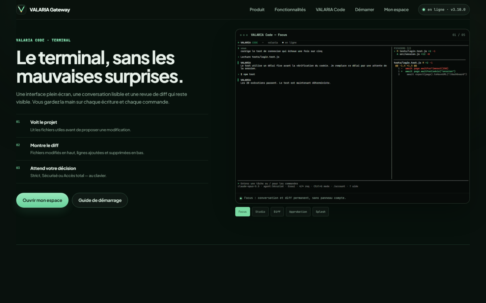
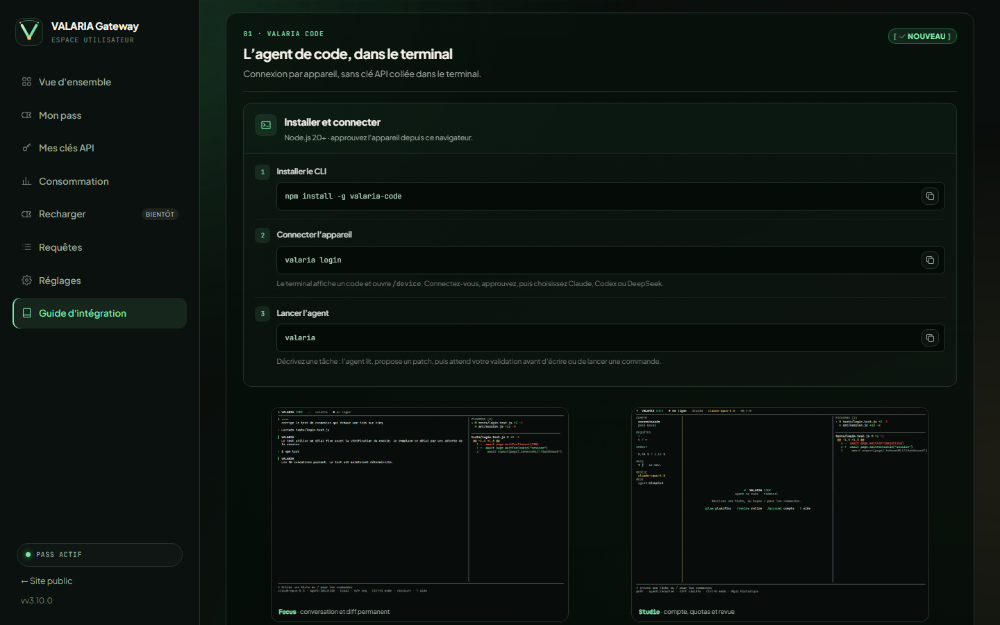
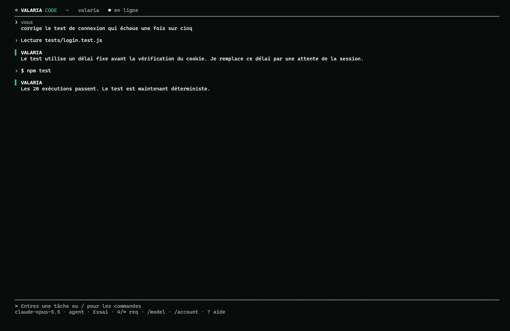

# Guide d’utilisation — VALARIA Code

VALARIA Code est l’agent de code en terminal de VALARIA Gateway. Il se connecte
au site par autorisation d’appareil : aucune clé API complète n’est collée dans
le terminal.

## Installation

```bash
npm install -g valaria-code
valaria --version
```

Node.js 20 ou supérieur est requis.

## Première connexion

```bash
valaria login
```

1. Le terminal affiche un code et ouvre le portail.
2. Connectez-vous à votre espace VALARIA.
3. Vérifiez le code affiché.
4. Approuvez l’appareil.
5. Choisissez **Claude**, **Codex** ou **DeepSeek**, puis le modèle.

Le jeton est stocké dans `~/.valaria/code.json` avec des permissions restreintes.
Il est révocable depuis **Réglages → Appareils connectés**.

## Lancer l’agent

```bash
cd /chemin/du/projet
valaria
```

L’agent travaille dans le dossier courant. Décrivez simplement la tâche :

```text
> ajoute un test pour la fonction de calcul et lance-le
```

Il lit les fichiers, propose un patch, puis demande votre validation avant
d’écrire ou de lancer une commande.

## Mémoire de conversation

VALARIA Code sauvegarde automatiquement la conversation **par projet** dans
`~/.valaria/sessions/`. Au prochain lancement dans le même dossier, l’historique
est repris et l’agent tient compte des échanges précédents.

- aucune commande spéciale n’est nécessaire : écrivez directement votre demande ;
- `valaria chat "..."` partage la même mémoire ;
- `/new` ou `valaria --new` efface la conversation du projet courant ;
- seuls les messages utilisateur/assistant sont conservés ; les détails internes
  des outils ne polluent pas le fichier ;
- le contexte envoyé au modèle est limité aux derniers échanges pour rester
  rapide.

```text
> /session
Session 12 message(s) · dernière activité 12/11/2026 08:42
> /new
Nouvelle conversation.
```

## Interfaces

```bash
valaria --layout focus    # conversation + revue compacte
valaria --layout studio   # compte à gauche, conversation au centre, diff à droite
valaria --layout compact  # une ligne de compte
valaria preview           # aperçu statique
valaria preview --splash  # revoir l’animation de démarrage
```

Dans la TUI :

| Commande | Effet |
|---|---|
| `/layout focus\|studio\|compact` | changer d’interface |
| `Ctrl+P` | faire défiler les interfaces |
| `/account` ou `Ctrl+O` | ouvrir compte, pass et quotas |
| `PgUp` / `PgDn` | faire défiler la conversation |
| `/diff` | actualiser/afficher le diff permanent |
| `/diff off` | masquer le diff |

## Modes d’approbation

| Mode | Commande | Comportement |
|---|---|---|
| Strict | `/1` | chaque écriture et commande demandent `y`/`n` |
| Sécurisé | `/2` | approbation seulement pour fichiers sensibles et commandes dangereuses |
| Accès total | `/3` | aucune approbation |

```text
Ctrl+G   cycle Strict → Sécurisé → Accès total
Alt+M    même cycle
```

`Ctrl+M` ne peut pas être utilisé : le terminal l’envoie comme la touche Entrée.
Le mode actif est affiché dans la ligne d’état et enregistré dans la configuration.

### Actions considérées comme dangereuses

- fichiers `.env`, secrets, lockfiles, `.github`, Docker ;
- commandes telles que `rm -rf`, `git reset --hard`, `git push --force`, `sudo`,
  `npm publish`, `curl … | sh`…

## Revue de diff

Le diff est visible en permanence dans la colonne de droite par défaut :

- liste compacte des fichiers modifiés/ajoutés/supprimés en haut ;
- diff du fichier sélectionné en dessous ;
- lignes `+` en vert, `−` en rouge, avec numéros de ligne.

Une approbation d’écriture affiche le fichier proposé dans cette même revue.

```text
↑↓       changer de fichier
PgUp/PgDn faire défiler le diff
d        agrandir/réduire la revue
y / n    autoriser / refuser
Échap    fermer
```

## Parcours guidés

```text
/interview          questions de clarification
/plan <objectif>    plan sans modification
/review             revue du diff courant
/diff               actualiser le diff
```

Après une réponse, les suggestions `1/2/3` permettent d’enchaîner.

## Commandes utiles

```text
/agent <tâche>      relancer explicitement l’agent
/chat <message>     conversation simple sans outils
/new · /clear       effacer la mémoire du projet courant
/session            afficher la session mémorisée
/files [dossier]    lister le projet
/read <fichier>     ajouter un fichier au contexte
/edit <fichier> <instruction>
/run <commande>     commande avec approbation selon le mode
/models             modèles disponibles
/model <nom>        changer de modèle
/usage              quotas et consommation
/animations on|off  splash, spinner, pulse
/quit
```

L’agent peut aussi lire une plage de lignes, remplacer un extrait précis
(`replace_in_file`), consulter Git (`git_status`, `git_diff`) et charger les
instructions du projet (`AGENTS.md`, `VALARIA.md`, `CLAUDE.md`).

Désactiver les animations au lancement :

```bash
valaria --no-anim
```

## Captures

### Page d’accueil — section VALARIA Code



### Guide dans le portail



### TUI — conversation et diff permanent



## Dépannage

| Problème | Solution |
|---|---|
| `valaria login` ne trouve pas la page | vérifier l’URL du portail et la connexion réseau |
| Jeton expiré ou révoqué | `valaria logout` puis `valaria login` |
| L’agent demande le chemin du projet | lancer `valaria` depuis le dossier du projet, ou vérifier le dossier courant |
| Le diff est vide | le projet n’a peut-être aucun changement Git, ou `/diff` doit être actualisé |
| Trop d’approbations | `/2` en mode Sécurisé, ou `/3` en Accès total |
| Aucun affichage du logo | terminal sans animations : vérifier `--no-anim`, `NO_COLOR` ou `VALARIA_NO_ANIMATION` |

## Sécurité

- approbation avant écriture selon le mode ;
- approbation avant commande selon le mode ;
- périmètre fichier confiné au projet ;
- jeton d’appareil hashé côté serveur, révocable ;
- configuration locale `~/.valaria/code.json` en `0600` ;
- aucune clé API complète demandée dans le terminal.
