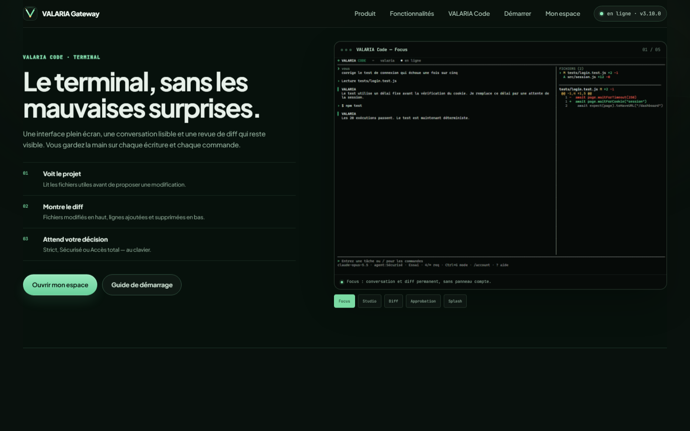
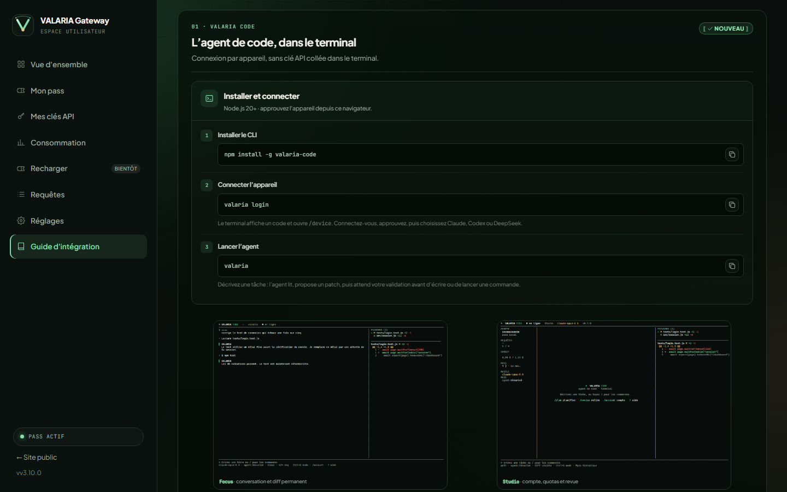
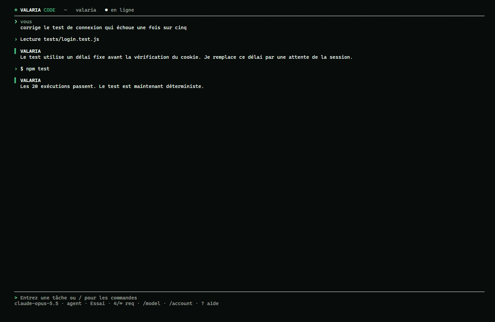

# Guide d’utilisation VALARIA

Ce guide vous accompagne de la création du compte jusqu’au travail quotidien, avec
l’API comme avec VALARIA Code, l’agent de code du terminal.

- [1. Votre compte](#1-votre-compte)
- [2. Utiliser l’API](#2-utiliser-lapi)
- [3. VALARIA Code](#3-valaria-code)
- [4. Limites et erreurs](#4-limites-et-erreurs)
- [5. Dépannage](#5-dépannage)
- [6. Sécurité](#6-sécurité)

## 1. Votre compte

### Créer le compte

1. Ouvrez la page **Créer un compte** (`/signup`).
2. Choisissez un nom d’utilisateur et indiquez votre email.
3. Saisissez le code à 6 chiffres reçu par email. Seul le dernier code envoyé fonctionne.

Votre espace s’ouvre avec un pass d’essai et votre clé API personnelle.

### Votre clé API

La clé commence par `sk-dsk-`. Elle ne s’affiche qu’une fois, à sa création :
copiez-la tout de suite et rangez-la dans un gestionnaire de mots de passe.

Si vous la perdez, ouvrez **Mes clés API** et régénérez-la. L’ancienne clé cesse
de fonctionner immédiatement.

### Se reconnecter

Sur la page **Mon espace** (`/portal`), connectez-vous avec votre clé, ou avec un
code reçu par email si vous ne l’avez plus sous la main.

### Les pass

| Pass | Durée | Crédit | Plafond sur 5 h | Plafond par semaine | Clés |
|---|---|---|---|---|---|
| Découverte | 7 jours | 5 $ | 5 $ | 5 $ | 1 |
| Créateur | 14 jours | 15 $ | 10 $ | 15 $ | 3 |
| Équipe | 30 jours | 40 $ | 20 $ | 40 $ | 8 |
| Business | 30 jours | 100 $ | 50 $ | 100 $ | 25 |

Le crédit est exprimé en crédit site, pas en euros payés. Un pass s’arrête à sa
date de fin ou quand son crédit est épuisé, au premier des deux. Il ne se
renouvelle jamais tout seul : vous le prolongez depuis **Mon pass**. Les prix
affichés dans votre espace font foi.

## 2. Utiliser l’API

L’API accepte deux formats avec la même clé.

| Format | URL de base | Authentification |
|---|---|---|
| OpenAI | `https://<votre-instance>/v1` | `Authorization: Bearer VOTRE_CLE_API` |
| Anthropic Messages | `https://<votre-instance>/anthropic` | `x-api-key: VOTRE_CLE_API` |

Les adresses exactes de votre instance sont affichées dans **Réglages** et dans le
**Guide d’utilisation** de votre espace.

### Premier appel

```bash
curl https://<votre-instance>/v1/chat/completions \
  -H "Authorization: Bearer VOTRE_CLE_API" \
  -H "Content-Type: application/json" \
  -d '{"model":"NOM_DU_MODELE","messages":[{"role":"user","content":"Bonjour"}]}'
```

Utilisez l’identifiant exact d’un modèle listé dans votre espace.

### Avec le SDK OpenAI

```python
from openai import OpenAI

client = OpenAI(api_key="VOTRE_CLE_API", base_url="https://<votre-instance>/v1")
response = client.chat.completions.create(
    model="NOM_DU_MODELE",
    messages=[{"role": "user", "content": "Bonjour"}],
)
print(response.choices[0].message.content)
```

Ajoutez `"stream": true` pour recevoir la réponse au fil de l’eau, et
`"stream_options": {"include_usage": true}` pour obtenir le nombre de tokens à la
fin du flux.

### Avec Claude Code ou Codex CLI

La configuration à copier, déjà remplie avec vos adresses, se trouve dans le
**Guide d’utilisation** de votre espace :

- Claude Code lit `~/.claude/settings.json` (`ANTHROPIC_BASE_URL`, `ANTHROPIC_AUTH_TOKEN`, `ANTHROPIC_MODEL`) ;
- Codex CLI lit `~/.codex/config.toml` et la variable d’environnement `VALARIA_API_KEY`.

## 3. VALARIA Code

VALARIA Code est un agent de code qui travaille dans le dossier de votre projet.
Il se connecte à votre compte par votre navigateur : vous n’avez aucune clé API à
coller dans le terminal.

### Installer

```bash
npm install -g valaria-code
valaria --version
```

Il faut Node.js 20 ou plus récent.

### Connecter le terminal

```bash
valaria login
```

1. Le terminal affiche un code et ouvre la page `/device` dans votre navigateur.
2. Connectez-vous à votre espace si ce n’est pas déjà fait.
3. Vérifiez que le code de la page est le même que celui du terminal. Si
   quelqu’un vous a envoyé ce lien, n’autorisez pas.
4. Cochez la confirmation et autorisez l’appareil.
5. De retour dans le terminal, choisissez **Claude**, **Codex** ou **DeepSeek**,
   puis le modèle.

Le code est valable 10 minutes. L’accès accordé dure 90 jours. Le jeton est
enregistré dans `~/.valaria/code.json`, lisible par vous seul. Vous pouvez le
révoquer à tout moment dans **Réglages → Appareils connectés**.

### Travailler avec l’agent

```bash
cd /chemin/du/projet
valaria
```

Décrivez la tâche en langage courant :

```text
> ajoute un test pour la fonction de calcul et lance-le
```

L’agent lit les fichiers utiles et les consignes du projet (`AGENTS.md`,
`VALARIA.md`, `CLAUDE.md`), propose un changement, puis demande votre accord
selon le niveau d’approbation choisi.

### Niveaux d’approbation

| Niveau | Commande | Ce que l’agent vous demande |
|---|---|---|
| Strict | `/1` | chaque écriture de fichier et chaque commande |
| Sécurisé | `/2` | seulement les fichiers sensibles et les commandes risquées |
| Accès total | `/3` | rien |

`Ctrl+G` ou `Alt+M` passe d’un niveau à l’autre. Le niveau actif s’affiche dans
la ligne d’état et reste enregistré pour la prochaine fois. `Ctrl+M` ne peut pas
servir de raccourci : le terminal l’envoie comme la touche Entrée.

En mode Sécurisé, l’agent vous demande votre accord pour :

- les fichiers `.env`, les secrets, les lockfiles, le dossier `.github` et les fichiers Docker ;
- les commandes comme `rm -rf`, `git reset --hard`, `git push --force`, `sudo`,
  `npm publish` ou `curl … | sh`.

Réservez l’Accès total aux projets que vous pouvez restaurer avec Git.

### Le diff

Le diff reste affiché à droite pendant tout le travail : les fichiers modifiés en
haut, le contenu du fichier sélectionné en dessous, avec les lignes ajoutées en
vert et les lignes supprimées en rouge. Quand l’agent veut écrire, le changement
proposé apparaît au même endroit.

```text
↑ ↓        changer de fichier
PgUp PgDn  faire défiler le diff
d          agrandir ou réduire la revue
y / n      autoriser / refuser
Échap      fermer
```

`/diff` actualise le diff, `/diff off` le masque.

### La mémoire du projet

La conversation est sauvegardée par projet dans `~/.valaria/sessions/`. Au
lancement suivant dans le même dossier, l’agent reprend où vous vous étiez
arrêtés. `valaria chat "..."` utilise la même mémoire.

```text
> /session
Session 12 message(s) · dernière activité 12/11/2026 08:42
> /new
Nouvelle conversation.
```

Seuls vos messages et les réponses de l’agent sont conservés. Pour rester rapide,
l’agent n’envoie au modèle que les derniers échanges. `/new` (ou `valaria --new`)
efface la conversation du projet courant.

### Les interfaces

```bash
valaria --layout focus    # la conversation et le diff
valaria --layout studio   # votre compte à gauche, la conversation au centre, le diff à droite
valaria --layout compact  # une seule ligne pour le compte
valaria preview           # aperçu statique de l’interface
valaria preview --splash  # revoir l’écran d’accueil animé
valaria --no-anim         # démarrer sans animations
```

| Raccourci ou commande | Effet |
|---|---|
| `/layout focus\|studio\|compact` | changer d’interface |
| `Ctrl+P` | passer à l’interface suivante |
| `/account` ou `Ctrl+O` | voir votre compte, votre pass et vos limites |
| `PgUp` / `PgDn` | faire défiler la conversation |

### Les commandes

```text
/interview          l’agent vous pose des questions pour préciser la demande
/plan <objectif>    un plan, sans modifier aucun fichier
/review             une relecture du diff en cours
/agent <tâche>      relancer l’agent sur une tâche
/chat <message>     discuter sans que l’agent touche aux fichiers
/files [dossier]    lister les fichiers du projet
/read <fichier>     ajouter un fichier au contexte
/edit <fichier> <instruction>
/run <commande>     lancer une commande, avec approbation selon le niveau
/models             voir les modèles disponibles
/model <nom>        changer de modèle
/usage              voir vos limites et votre consommation
/animations on|off  activer ou couper les animations
/new · /clear       effacer la mémoire du projet
/session            voir la session enregistrée
/quit               quitter
```

Après une réponse, des suggestions numérotées `1`, `2`, `3` permettent
d’enchaîner sans retaper la demande.

## 4. Limites et erreurs

Chaque réponse de l’API contient vos compteurs dans les en-têtes `x-quota-…`
(par exemple `x-quota-usd-remaining` pour le crédit restant).

Quand une requête est refusée, le champ `error.code` de la réponse indique la
raison :

| Statut | `error.code` | Signification | Que faire |
|---|---|---|---|
| 401 | | clé absente, invalide ou régénérée depuis | vérifier l’en-tête d’authentification |
| 403 | `client_disabled` | accès désactivé par l’administrateur | contacter l’administrateur |
| 403 | `client_expired` | pass arrivé à sa date de fin | renouveler le pass dans **Mon pass** |
| 404 | | modèle ou adresse inconnus | utiliser un modèle listé et l’URL de base exacte |
| 429 | `rate_limit_exceeded` | trop de requêtes par minute | attendre le délai de l’en-tête `Retry-After` |
| 429 | `concurrency_limit_exceeded` | trop d’appels en même temps | attendre la fin d’un appel en cours |
| 429 | `credit_window_exceeded` | plafond de crédit sur 5 heures atteint | réessayer plus tard |
| 429 | `credit_week_exceeded` | plafond de crédit de la semaine atteint | attendre la semaine suivante ou changer de pass |
| 429 | `insufficient_quota` | crédit du pass épuisé | renouveler le pass |

## 5. Dépannage

| Problème | Solution |
|---|---|
| `valaria login` n’ouvre pas la page | copiez l’adresse affichée dans le terminal dans votre navigateur, et vérifiez la connexion réseau |
| Le code de connexion a expiré | relancez `valaria login` : le code dure 10 minutes |
| Jeton expiré ou révoqué | `valaria logout`, puis `valaria login` |
| L’agent ne trouve pas votre projet | lancez `valaria` depuis le dossier du projet |
| Le diff est vide | le projet n’a peut-être aucun changement Git ; actualisez avec `/diff` |
| L’agent demande trop souvent votre accord | passez en Sécurisé avec `/2` |
| Le logo ou les animations ne s’affichent pas | vérifiez `--no-anim`, `NO_COLOR` et `VALARIA_NO_ANIMATION` |
| Erreur 401 avec le SDK | la clé a peut-être été régénérée : copiez la nouvelle |

## 6. Sécurité

- Votre clé API n’est jamais envoyée au terminal : VALARIA Code utilise un jeton
  d’appareil, que vous pouvez révoquer.
- Le serveur ne garde qu’une empreinte de ce jeton, pas le jeton lui-même.
- Le fichier `~/.valaria/code.json` n’est lisible que par vous (permissions `0600`).
- L’agent ne peut lire et écrire que dans le dossier du projet.
- Selon le niveau choisi, l’agent vous demande votre accord avant d’écrire un
  fichier ou de lancer une commande.

## Captures

Section VALARIA Code de la page d’accueil :



Guide dans votre espace :



VALARIA Code, la conversation et le diff :


